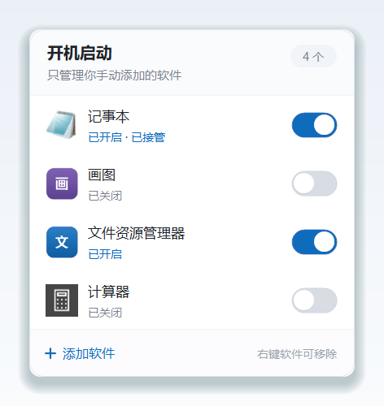

# 自启开关（TrayStartup）

一个常驻 Windows 系统托盘的迷你工具，只管理**你手动添加的少数几个软件**是否开机启动（典型 4 个左右）。左键托盘图标弹出面板，每行一个滑动开关，开关直接对应 `HKCU\Software\Microsoft\Windows\CurrentVersion\Run` 里的那一个值。



## 特性

- 常驻托盘，不占任务栏；单实例运行，重复双击唤起已有面板
- 完全自绘的多 DPI 面板：圆角、滑动开关、滚动列表、置顶
- **只管理你添加的软件**：只碰配置文件里记录的软件对应的注册表值，不扫描、不清理别的启动项
- **默认安全**：新添加的软件默认关闭，不擅自开启
- **可回退**：删除启动项前先校验命令目标；配置原子写入并保留 `.bak`
- 接管已有的同名 Run 值，保留原 valueName 与启动参数
- 添加时检测 HKLM Run、用户/公共启动文件夹，并提示"另有启动方式"
- 免安装、单文件、无第三方依赖、不联网、不需要管理员权限

## 系统要求

- Windows 10 / Windows 11（x64）
- .NET Framework 4.8（Win10 1903+ 与 Win11 自带）

## 构建

```powershell
dotnet build -c Release --no-incremental
# 产物：bin\Release\net48\TrayStartup.exe
```

需要 .NET SDK 与 .NET Framework 4.8 Developer Pack（缺少时报警 `MSB3644`）。

## 使用

1. 运行 `TrayStartup.exe`，托盘出现图标（Win11 可能被收进 `^`，拖出来即可）
2. 左键图标打开面板 →「＋ 添加软件」选择 `.exe`
3. 拨动开关即写入/删除当前用户的启动项

右键托盘：添加软件、随 Windows 启动、退出。右键软件行：打开文件所在位置、移除并关闭自启。

配置位于 `%APPDATA%\TrayStartup\apps.json`，与 exe 分离，移动程序不会丢配置。

## ⚠️ 关于未签名与安全软件提示

本程序**没有代码签名**，首次运行时可能遇到：

- **SmartScreen**：提示"未知发布者"或"Windows 已保护你的电脑"，点"更多信息"→"仍要运行"
- **杀毒软件**：安全软件对未签名程序写启动项比较敏感，请把它加入信任区；弹窗时选"信任运行/正常启动"，**不要选"沙箱运行"**

如果被沙箱或降权运行，会出现"进程在跑但不显示托盘图标、`%APPDATA%\TrayStartup` 不生成"的现象。这是环境限制，不是程序故障；从源码自行编译也同样需要放行。

## 能力边界

只直接管理 `HKCU\...\Run`。HKLM Run、启动文件夹只检测并提示；计划任务、服务、驱动、应用自身设置不在管理范围——"开关关了还自启"多半是这些机制，详见技术文档。

## 目录结构

```
TrayStartup.csproj   net48、WinForms、AnyCPU、内嵌图标
app.manifest         asInvoker、系统 DPI 感知
app.ico              多尺寸程序图标
src/                 全部源码
tools/               图标生成与审计脚本
```

## 许可

[MIT License](LICENSE) © 2026 Luvsicpt2
